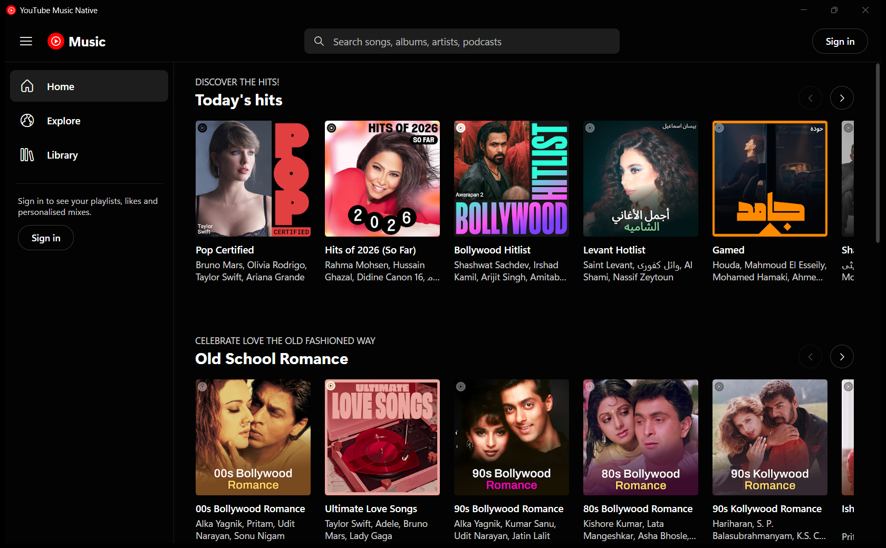
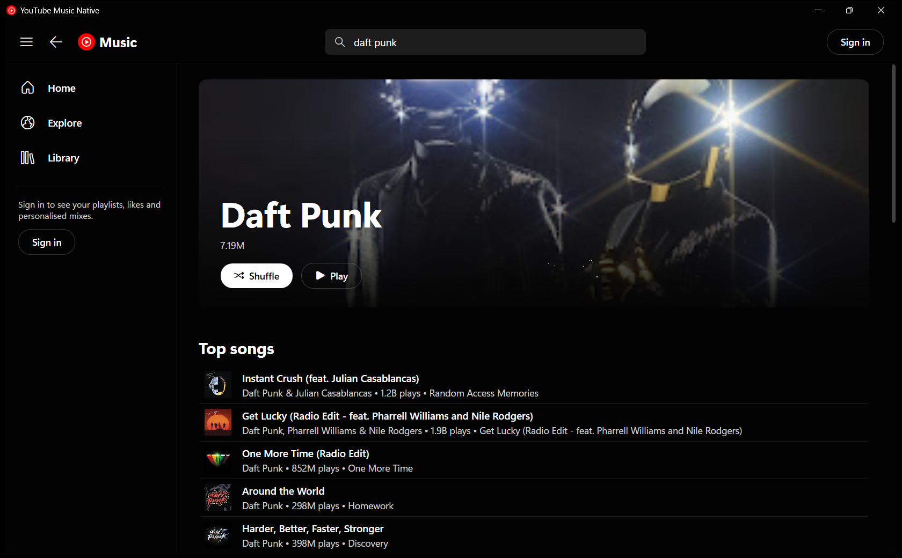
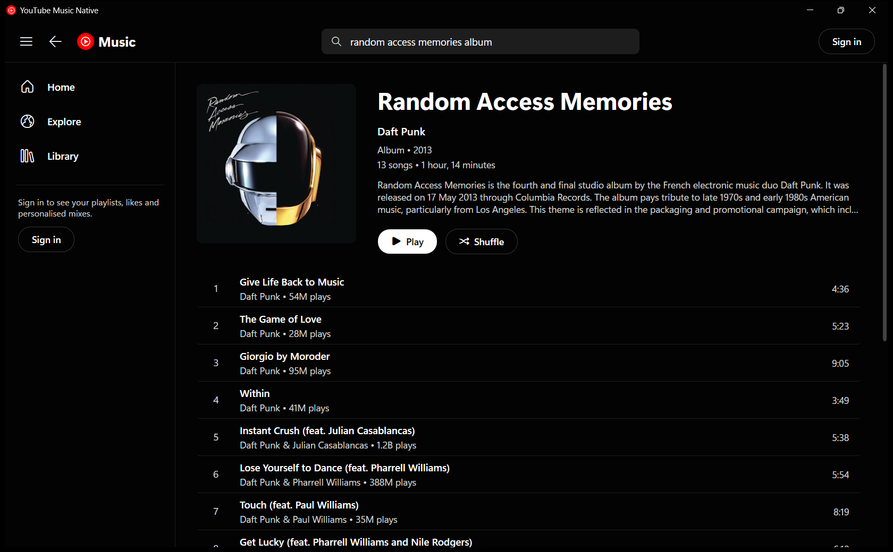
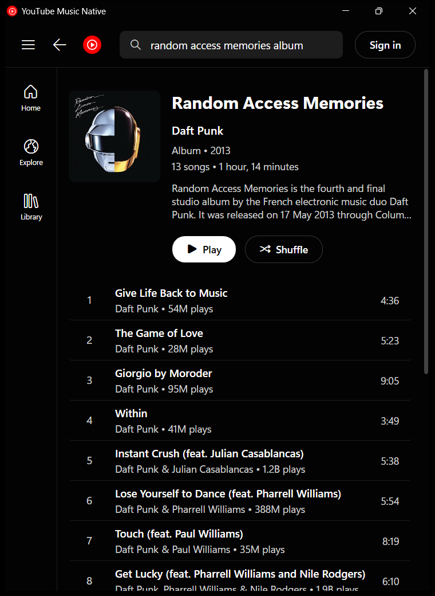

<div align="center">


# YouTube Music Native

**A lightweight, native YouTube Music client for Windows. No Chromium, no Electron.**

[](https://github.com/SaumyajitG/YoutubeMusicNative/releases/latest)
[](https://github.com/SaumyajitG/YoutubeMusicNative/releases)
[](https://github.com/SaumyajitG/YoutubeMusicNative/actions)


[Download](#-download) · [Features](#-features) · [Build from source](#-build-from-source) · [FAQ](#-faq)

</div>

---

## 💡 Why I made this

> I was tired of all the Chromium-based web implementations of YT Music that used a ton of RAM, and wanted something native to Windows (i.e. my work PC) and responsive.

YouTube Music Native is written in C# with WPF and plays audio through the Windows media stack. There's no embedded browser in the main window.

> [!IMPORTANT]
> This is an unofficial, personal project. It is not affiliated with, endorsed by, or connected to Google or YouTube.

## 📸 Screenshots

<div align="center">



<br/><br/>




<br/><br/>



<sup>The layout adapts as you resize: the sidebar collapses to icons and secondary controls hide.</sup>

</div>

## ✨ Features

- **Looks like YouTube Music:** dark theme, home shelves, Explore, Library, artist / album / playlist pages
- **Search** with live suggestions
- **Radio & "Up next" queue:** clicking a song starts a radio that keeps extending itself. Also has shuffle, repeat, and Play next / Add to queue (right-click)
- **Edit the queue:** drag songs by their ≡ handle to reorder them, or remove them with the 🗑 button or the right-click menu
- **Dark & light themes:** switch from ⚙ Settings
- **Responsive layout** that adapts to any window size
- **Seamless playback:** the next song in the queue (including songs you add) is downloaded in the background, so it starts instantly
- **Native Windows integration:** media keys, the volume flyout, lock-screen controls, and Previous / Play-Pause / Next buttons in the taskbar preview, plus a dark title bar with snap layouts
- **Light on resources:** about 65–95 MB of private RAM while browsing and playing, under 20 MB when minimized. Uses virtualized lists, images decoded at display size, and a single-file exe
- **Sign in with Google** in a browser window. Only the resulting session cookie is stored, encrypted with Windows DPAPI.
  While you're signed in, songs are fetched with your account, so tracks YouTube refuses anonymously still play. You can turn this off in ⚙ Settings.

## 📦 Download

<details open>
<summary><b>GitHub release (recommended)</b></summary>

1. Install the **.NET 10 Desktop Runtime** if you don't have it:
   ```powershell
   winget install Microsoft.DotNet.DesktopRuntime.10
   ```
2. Download `YoutubeMusicNative.exe` from the [latest release](https://github.com/SaumyajitG/YoutubeMusicNative/releases/latest) and run it. No installer needed.

</details>

<details>
<summary><b>Run from source</b></summary>

See [Build from source](#-build-from-source).

</details>

**Requirements:** Windows 10 (version 2004 / build 19041) or Windows 11 (x64). Sign-in uses the Microsoft Edge WebView2 Runtime, which is preinstalled on Windows 11.

## 🚀 Usage

| Action | How |
| --- | --- |
| Play / pause | <kbd>Space</kbd> or your keyboard's media keys |
| Search | <kbd>Ctrl</kbd>+<kbd>F</kbd> or <kbd>/</kbd> |
| Go back | <kbd>Alt</kbd>+<kbd>←</kbd> or the mouse back button |
| Scroll a shelf sideways | <kbd>Shift</kbd>+mouse wheel, or the ‹ › buttons |
| Song options | Right-click a song |
| Up next queue | Click the now-playing area or the ⌃ button in the player bar |

**Signing in:** click **Sign in** (top right), sign in with your Google account in the window that opens, and it closes by itself. Sign out from the avatar menu.

## 🛠 Build from source

Requires the [.NET 10 SDK](https://dotnet.microsoft.com/download/dotnet/10.0).

```powershell
git clone https://github.com/SaumyajitG/YoutubeMusicNative.git
cd YoutubeMusicNative

# run
dotnet run --project src/YoutubeMusicNative

# single-file release exe → publish/YoutubeMusicNative.exe
dotnet publish src/YoutubeMusicNative -c Release -o publish
```

Releases are built by GitHub Actions ([`release.yml`](.github/workflows/release.yml)) whenever a `v*` tag is pushed.

<details>
<summary><b>Project layout</b></summary>

```
src/YoutubeMusicNative/
├── Services/        InnerTube API client, response parser, stream resolver, player, auth, settings
├── ViewModels/      MVVM view models (pages are flattened into virtualized rows)
├── Views/           Player bar, carousels, page view, sign-in window
├── Themes/          Colours, control styles, row/card templates
└── Infrastructure/  Image loader/cache, JSON helpers, DPAPI, converters
```

</details>

## ❓ FAQ

<details>
<summary><b>Some songs won't play. Why?</b></summary>

YouTube bot-checks stream URLs. The app first tries direct streams. If those are blocked, it falls back to
[yt-dlp](https://github.com/yt-dlp/yt-dlp), which it downloads to `%LOCALAPPDATA%\YoutubeMusicNative` the first time it's needed.
On networks that YouTube has flagged, some tracks may still fail to play.

</details>

<details>
<summary><b>Where is my data stored?</b></summary>

Everything lives in `%LOCALAPPDATA%\YoutubeMusicNative`: settings, the encrypted session (`secrets.bin`),
the sign-in browser profile, and `error.log`. Delete the folder to reset the app.

</details>

<details>
<summary><b>Why WPF and not WinUI / Electron / Tauri?</b></summary>

WPF starts fast, ships as a single exe, needs no extra runtime packaging, and renders on the GPU.
Electron and web-view shells bundle or host a full browser engine, which is exactly the RAM cost this project avoids.

</details>
